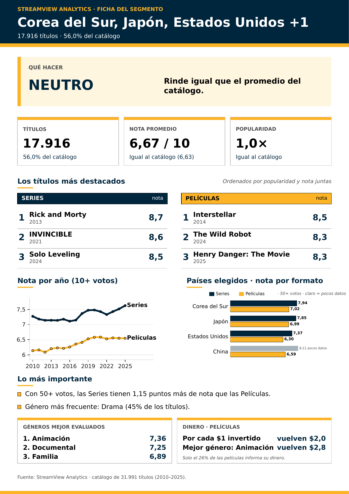

# StreamView Analytics — ¿Dónde conviene invertir el presupuesto de contenido?

**Asignatura:** ADY1104 — Visualización de Datos · Duoc UC
**Docente:** Guillermo Pinto
**Integrantes:** Genesis Baeza, Jimena Galicia
**Entrega:** Evaluación Parcial N°3 — Encargo (EP5) y presentación y defensa (EP6) · 17/11/26

**Dashboard publicado:** https://streamview-dashboard-jiyvcvrpgkgharyjkax8b3.streamlit.app/

Este repositorio contiene el **dashboard interactivo** (Streamlit) y el **notebook de análisis** (Google Colab) del caso StreamView Analytics. Los dos usan el mismo código (`src/`), los mismos datos, las mismas reglas y la misma paleta, así que sus cifras coinciden.

---

## 1. Qué responde el proyecto

StreamView administra un catálogo de **31.991 títulos** (16.000 películas y 15.991 series, 2010–2025). Sus áreas usan reportes distintos y las decisiones de inversión se toman con información parcial. El proyecto responde una pregunta: **¿qué segmentos del catálogo conviene priorizar?**

| Hallazgo | Evidencia |
|---|---|
| Las Series puntúan más que las Películas | Con 50+ votos por título (el mismo umbral que se exige a los países): 7,52 vs. 6,39 sobre 10 (+1,13). Ganan en los 16 años y en los 8 géneros comparables. Sin mínimo de votos la ventaja es +0,72. |
| La ventaja no depende del país | En los 6 países con 100+ series y 100+ películas con 50+ votos, las Series ganan: de +0,75 (México) a +1,14 (Canadá). |
| Dentro de las Series, Animación y Familia son los géneros mejor evaluados | Con 50+ votos y al menos 100 series por género: Animación 7,79 (784 series) y Familia 7,61 (219 series). |
| Popularidad y nota se relacionan solo en parte | Dentro de cada formato (50+ votos): ρ = 0,24 en Películas y 0,25 en Series. |
| Entre los países, la nota solo es comparable con votos suficientes | Con 50+ votos y 100+ series: Corea del Sur 7,94 y Japón 7,85. China tiene 1.900 series, pero solo 39 con 50+ votos. |
| En películas, el retorno cuenta una historia distinta a la nota | Terror: ROI mediano 2,5× frente a 1,8× de la película típica. **Solo las películas informan dinero**, y solo el 21% de ellas. |

**Audiencia:** Comité Directivo de Contenido, con apoyo de Data & Analytics y Marketing.

### Recomendaciones (las mismas en el dashboard, el informe y la presentación)

1. **Priorizar Series de calidad**, empezando por Animación y Familia.
2. **Mirar primero Corea del Sur y Japón**; Estados Unidos conserva la mayor escala.
3. **No decidir por popularidad sola**: usar el índice combinado de popularidad y nota.
4. **Evaluar Terror por retorno**, confirmando con costos reales.
5. **No recomendar países con pocos datos** (por ejemplo, China).
6. **Cruzar con datos de comportamiento real** (retención y tiempo de visualización).

---

## 2. Qué cambió en esta entrega (según la retroalimentación)

| Observación del docente | Qué hicimos |
|---|---|
| Agregar un filtro por país | Filtro «País de producción» en todo el dashboard, comparación de países en la pestaña 4 y, en la infografía, comparación de hasta 6 países separada por formato. |
| La justificación técnica debe partir de los requerimientos | El informe justifica cada herramienta desde un requerimiento del caso. |
| Aplicar el umbral de votos a «priorizar Series» | La recomendación usa 50+ votos: +1,13 (antes +0,72 con todos los títulos). La tarjeta de diferencia del dashboard muestra las dos cifras. |
| Revisar la ortografía | Revisión de textos del dashboard, notebook, informe y presentación. |

Además:

- **Títulos que se recalculan:** los títulos y lecturas de las pestañas 1 y 2 cambian con el filtro. Por ejemplo, con Chile dicen que las Películas puntúan más, en vez de repetir el mensaje general.
- **Nota por año:** el gráfico cuenta solo títulos con 10+ votos.
- **Pestaña 6:** tiene las mismas 6 recomendaciones del informe.
- **Notebook:** tiene una sección nueva con la materia de las últimas clases.

---

## 3. Estructura del repositorio

```
streamview-dashboard/
├── README.md
├── requirements.txt
├── .devcontainer/devcontainer.json    <- Entorno para GitHub Codespaces
├── .streamlit/config.toml             <- Tema de colores del dashboard
├── dashboard/
│   └── dashboard_streamview_analytics.py   <- Dashboard (Streamlit)
├── data/                              <- Los dos CSV entregados por el docente
├── notebooks/
│   └── StreamView_Notebook_Analisis.ipynb  <- Notebook de análisis (Colab), ejecutado con resultados
├── images/                            <- Infografías de ejemplo
└── src/
    ├── utils_datos.py                 <- Limpieza, filtros y cálculos (una sola fuente de verdad)
    ├── infografia.py                  <- Genera la infografía A4 (matplotlib)
    └── paleta.py                      <- Colores y estilo de los gráficos
```

`utils_datos.py` concentra toda la lógica de datos. El dashboard la importa y el notebook contiene el mismo código, así que las cifras no pueden contradecirse. Las reglas de confiabilidad son constantes de ese archivo: `VOTOS_CONFIABLE` = 50, `MIN_TITULOS_GRUPO` = 100, `VOTOS_ANIO` = 10 y `MIN_TITULOS_ANIO` = 10.

---

## 4. Cómo ejecutar

**Dashboard (en tu computador):**

```bash
pip install -r requirements.txt
streamlit run dashboard/dashboard_streamview_analytics.py
```

Si `streamlit` no se reconoce en Windows: `python -m streamlit run dashboard/dashboard_streamview_analytics.py`.
El dashboard **busca solo la carpeta `data/`**, así que se puede lanzar desde cualquier carpeta del proyecto.

**Notebook:**
1. Abrir `notebooks/StreamView_Notebook_Analisis.ipynb` en Google Colab.
2. Subir los dos CSV de `data/` al panel izquierdo. Si falta alguno, la sección 2 muestra un botón para subirlo.
3. Menú *Entorno de ejecución → Ejecutar todo*.

La sección 13 ejecuta verificaciones automáticas: si una cifra no coincide con la del dashboard, el notebook se detiene con un aviso.

---

## 5. El dashboard

**Filtros** (panel izquierdo y selector superior):
- **Qué filtran:** formato, año de lanzamiento, mínimo de votos, género y **país de producción**. Todo se recalcula con ellos, salvo la pestaña 6, que usa siempre el catálogo completo.
- **Países:** un título entra si al menos uno de sus países está elegido. Con uno o más países, la pestaña 4 compara solo esos y marca en gris los que no tienen base suficiente (menos de 100 series con 50+ votos).
- **Géneros:** los 8 géneros comparables llevan una **★**, porque existen en Películas y en Series.

**KPIs** (se recalculan con los filtros): títulos, calificación de Películas, calificación de Series, diferencia entre ambas y popularidad Series ÷ Películas. Debajo de la diferencia aparece la misma cifra con 50+ votos, que es la que usa la recomendación.

| Pestaña | Pregunta | Contenido |
|---|---|---|
| 1. La historia | ¿Qué está ocurriendo? | Nota por formato, evolución por año (títulos con 10+ votos) y cómo cambia la ventaja al exigir votos |
| 2. Géneros | ¿En qué géneros ocurre? | Nota y cantidad por género comparable, portafolio nota vs. popularidad |
| 3. Popular vs. bueno | ¿Lo popular es lo mejor evaluado? | Dispersión por título, ρ mezclado y por formato |
| 4. Países e idiomas | ¿De dónde viene el contenido? | Nota por país (50+ votos) con margen de error, comparación de los países elegidos, idiomas |
| 5. Finanzas | ¿Cuánto rinden las películas? | ROI por género, presupuesto vs. ingresos (solo películas) |
| 6. Qué decidir | ¿Qué decisiones se desprenden? | Seis decisiones, las mismas y en el mismo orden que el informe, con su evidencia e índice combinado |
| 7. Infografía | ¿Cómo comunico un segmento? | Selector de hasta 6 países y botón que genera una hoja A4 (PDF y PNG) con los filtros activos |
| Explorar datos | — | Tabla filtrable con descarga a CSV |

Cada pestaña empieza con la **respuesta corta** (caja amarilla) y cada gráfico indica la **pregunta que responde**. Los títulos de los gráficos dicen el hallazgo y, en las pestañas 1 y 2, se recalculan con los filtros.

### La infografía

La pestaña 7 convierte el segmento filtrado en una hoja A4 pensada para leerse en segundos, de arriba hacia abajo:

1. Título del segmento (con los países elegidos).
2. **Qué hacer:** una palabra de acción y una frase.
3. Tres cifras comparadas con el catálogo.
4. Los **3 títulos más destacados de cada formato**.
5. Nota por año y, a su derecha, la **comparación de los países elegidos por formato**. Si no se eligen países, se muestran los géneros mejor evaluados.
6. Dos frases con lo más importante.
7. Dos franjas: los mejores países para Series (o los géneros, si el gráfico ya muestra países) y **cuánto devuelve cada US$ 1 invertido en películas**.

**Comparación de países:** se eligen hasta 6 países y la hoja muestra la nota de cada uno separada por formato (Series en azul y Películas en amarillo), solo con títulos de 50+ votos. Si un formato tiene menos de 100 títulos así en ese país, su barra sale en color claro con «pocos datos». El filtro de país no usa umbral: el umbral solo se aplica para comparar notas entre países. El informe descargable agrega una tabla con la nota, el margen de error y la base de cada país.



---

## 6. El notebook

Sigue siempre el mismo orden: **pregunta → por qué este gráfico → gráfico → lectura con cifras → decisión**. Incluye:

- **Datos:** integración y calidad de las dos fuentes, con la bitácora de decisiones de limpieza.
- **Análisis:**
  - exploración del catálogo;
  - Series vs. Películas (con y sin umbral de votos);
  - años, géneros y países;
  - la ventaja de las Series dentro de cada país;
  - popularidad vs. nota;
  - retorno de las películas.
- **Reglas y decisiones:** prueba de por qué se exige un mínimo de votos, KPIs y las 6 recomendaciones.
- **Infografía:** un formulario para generar la hoja A4 con cualquier segmento. Tiene los campos `pais_filtro` y `paises_a_comparar`, que aceptan nombres con o sin tilde.
- **Sección 12 · Evaluación crítica y diseño estratégico** (materia de las últimas clases):
  - Design Thinking, árbol de preguntas, Progressive Disclosure e Information Scent;
  - el framework de evaluación en 5 pasos;
  - sesgos medidos con datos, incluido el Lie Factor de un eje truncado;
  - restricciones y alternativas de diseño;
  - hoja de ruta de mejoras, Decision Brief e impacto esperado.
- **Sección 13 · Verificaciones automáticas** de todas las cifras.

---

## 7. Decisiones de diseño

- **Colores de Duoc UC, un solo significado cada uno:** amarillo `#FCB426` = Películas, azul oscuro `#00263E` = Series TV, gris o color claro = pocos datos, negro = solo texto.
- **Respuesta antes que evidencia:** los títulos comunican el hallazgo, no el tema del gráfico.
- **Barras siempre desde 0:** con el eje en 6, la diferencia entre 6,39 y 7,52 se vería 16 veces más grande (Lie Factor).
- **Popularidad con mediana y relación con Spearman (por rangos):** unos pocos títulos extremos no deben mandar sobre el resto.
- **Mínimo de votos:** una nota con pocos votos es poco confiable (la mitad de las series calificadas tiene menos de 10). Se exigen 50+ votos a todo lo que se recomienda: Series vs. Películas, géneros, países, rankings y relaciones. Para comparar un grupo (país o género) se exigen además 100+ títulos con ese mínimo. En la evolución por año solo cuentan títulos con 10+ votos, porque los estrenos recientes aún tienen muy pocos.

---

## 8. Reglas y limitaciones de los datos

- **Datos de catálogo, no de comportamiento:** no hay sesiones ni tiempo de visualización. La popularidad es un índice relativo, no reproducciones.
- **Muestra elegida:** cada año trae 1.000 películas y ~1.000 series, así que no se puede medir el crecimiento del catálogo.
- **Nota 0 = sin calificación** (4.564 títulos): no entra en los promedios.
- **8 géneros comparables:** Drama, Comedia, Animación, Crimen, Familia, Misterio, Documental y Western.
- **Finanzas:** solo las películas informan dinero, y solo ~21% de ellas con presupuesto e ingresos ≥ US$ 100.000. El ROI es bruto.
- **Países:** solo 6 países tienen base suficiente en ambos formatos; los demás se muestran como referencia.
- **Variables descartadas:** `duration`, `rating` y `date_added`.

---

## 9. Tecnologías

| Herramienta | Uso |
|---|---|
| Python · pandas · numpy | Carga, limpieza y cálculo |
| Plotly Express | Gráficos interactivos |
| Matplotlib | Infografía exportable (PNG y PDF) y gráficos del notebook |
| Streamlit · Streamlit Community Cloud | Dashboard y su publicación |
| Google Colab | Notebook de análisis |
| GitHub | Control de versiones |
