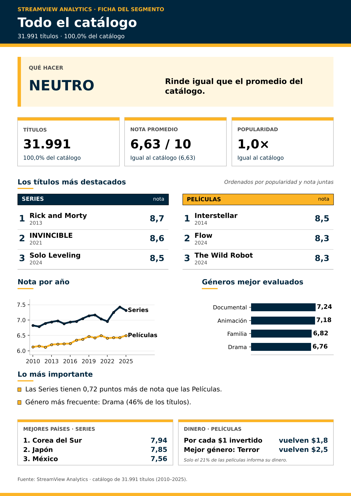

[README.md](https://github.com/user-attachments/files/33648849/README.md)
# StreamView Analytics — ¿Dónde conviene invertir el presupuesto de contenido?

**Asignatura:** ADY1104 — Visualización de Datos · Duoc UC
**Docente:** Guillermo Pinto
**Integrantes:** Genesis Baeza, Jimena Galicia

Este repositorio contiene el **dashboard interactivo** (Streamlit) y el **notebook de análisis** (Google Colab) del caso StreamView Analytics. Ambos usan los mismos datos, las mismas reglas y la misma paleta, por lo que sus cifras coinciden.

---

## 1. Qué responde el proyecto

StreamView administra un catálogo de **31.991 títulos** (16.000 películas y 15.991 series, 2010–2025). Sus áreas usan reportes distintos y las decisiones de inversión se toman con información parcial. El proyecto responde una pregunta: **¿qué segmentos del catálogo conviene priorizar?**

| Hallazgo | Evidencia |
|---|---|
| Las Series puntúan más que las Películas | 7,03 vs. 6,31 sobre 10 (+0,72). Ganan en los 16 años y en los 8 géneros comparables. Con 50+ votos la ventaja sube a +1,13. |
| Popularidad y nota se relacionan solo en parte | Dentro de cada formato (50+ votos): ρ = 0,24 en Películas y 0,25 en Series. |
| Entre los países, la nota solo es comparable con votos suficientes | Con 50+ votos y 100+ series: Corea del Sur 7,94 y Japón 7,85. China tiene 1.900 series, pero solo 39 con 50+ votos. |
| En películas, el retorno cuenta una historia distinta a la nota | Terror: ROI mediano 2,5× frente a 1,8× de la película típica (solo 21% de las películas informa presupuesto e ingresos). |

**Audiencia:** Comité Directivo de Contenido, con apoyo de Data & Analytics y Marketing.

---

## 2. Estructura del repositorio

```
streamview-dashboard/
├── README.md
├── requirements.txt
├── .devcontainer/devcontainer.json    <- Entorno para GitHub Codespaces
├── .streamlit/config.toml             <- Tema de colores del dashboard
├── dashboard/
│   └── dashboard_streamview_analytics.py   <- Dashboard (Streamlit)
├── data/                              <- Los dos CSV entregados por el docente
├── notebooks/                         <- Notebook de análisis (Colab)
├── images/                            <- Imágenes de ejemplo (infografías)
└── src/
    ├── utils_datos.py                 <- Limpieza, filtros y cálculos (una sola fuente de verdad)
    ├── infografia.py                  <- Genera la infografía A4 (matplotlib)
    └── paleta.py                      <- Colores y estilo de los gráficos
```

`utils_datos.py` concentra toda la lógica de datos; el dashboard la importa, así las cifras no pueden contradecirse.

---

## 3. Cómo ejecutar

**Dashboard (en tu computador):**

```bash
pip install -r requirements.txt
streamlit run dashboard/dashboard_streamview_analytics.py
```

Si `streamlit` no se reconoce en Windows: `python -m streamlit run dashboard/dashboard_streamview_analytics.py`.
El dashboard **busca solo la carpeta `data/`**, así que se puede lanzar desde cualquier carpeta del proyecto.

**Notebook:** abrir `notebooks/StreamView_Notebook_Analisis.ipynb` en Google Colab y ejecutar de arriba hacia abajo. Los dos CSV de `data/` se suben al panel izquierdo de Colab (si falta alguno, la sección 2 muestra un botón para subirlo).

---

## 4. El dashboard

**Filtros** (panel izquierdo y selector superior): formato, año de lanzamiento, mínimo de votos y género. Todo se recalcula con ellos, salvo la pestaña 6.

**KPIs** (se recalculan con los filtros): títulos, calificación de Películas, calificación de Series, diferencia entre ambas y popularidad Series ÷ Películas.

| Pestaña | Pregunta | Contenido |
|---|---|---|
| 1. La historia | ¿Qué está ocurriendo? | Nota por formato, evolución por año, prueba con votos mínimos |
| 2. Géneros | ¿En qué géneros ocurre? | Nota y cantidad por género comparable, portafolio nota vs. popularidad |
| 3. Popular vs. bueno | ¿Lo popular es lo mejor evaluado? | Dispersión por título, ρ mezclado y por formato |
| 4. Países e idiomas | ¿De dónde viene el contenido? | Nota por país (50+ votos), idiomas |
| 5. Finanzas | ¿Cuánto rinden las películas? | ROI por género, presupuesto vs. ingresos |
| 6. Qué decidir | ¿Qué decisiones se desprenden? | Cinco decisiones con su evidencia e índice combinado (5 mejores de cada formato) |
| 7. Infografía | ¿Cómo comunico un segmento? | Botón que genera una hoja A4 (PDF y PNG) con los filtros activos |
| Explorar datos | — | Tabla filtrable con descarga a CSV |

Cada pestaña empieza con la **respuesta corta** (caja amarilla) y cada gráfico indica la **pregunta que responde**, con la misma redacción del notebook. «Explorar datos» muestra la tabla de títulos detrás de las cifras, para comprobarlas y descargarlas.

### La infografía

La pestaña 7 convierte el segmento filtrado en una hoja A4: título, cifras comparadas con el catálogo completo, ranking, gráficos de apoyo, hallazgos y una recomendación. Si el segmento incluye Series y Películas, el ranking muestra **los 5 mejores de cada formato** para poder compararlos.



---

## 5. Decisiones de diseño

- **Colores de Duoc UC, un solo significado cada uno:** amarillo `#FCB426` = Películas, azul oscuro `#00263E` = Series TV, negro = solo texto.
- **Respuesta antes que evidencia:** los títulos comunican el hallazgo, no el tema del gráfico.
- **Popularidad con mediana y relación con Spearman (por rangos):** unos pocos títulos extremos no deben mandar sobre el resto.
- **Mínimo de votos:** una nota con pocos votos es poco confiable. Se exige 50+ votos al comparar países, rankings y relaciones.

---

## 6. Reglas y limitaciones de los datos

- **Datos de catálogo, no de comportamiento:** no hay sesiones ni tiempo de visualización. La popularidad es un índice relativo, no reproducciones.
- **Muestra elegida:** cada año trae 1.000 películas y ~1.000 series, así que no se puede medir el crecimiento del catálogo.
- **Nota 0 = sin calificación** (4.564 títulos): no entra en los promedios.
- **8 géneros comparables:** Drama, Comedia, Animación, Crimen, Familia, Misterio, Documental y Western.
- **Finanzas:** solo ~21% de las películas informa presupuesto e ingresos (≥ US$ 100.000). El ROI es bruto.
- **Variables descartadas:** `duration`, `rating` y `date_added`.

---

## 7. Tecnologías

| Herramienta | Uso |
|---|---|
| Python · pandas · numpy | Carga, limpieza y cálculo |
| Plotly Express | Gráficos interactivos |
| Matplotlib | Infografía exportable (PNG y PDF) |
| Streamlit | Dashboard |
| Google Colab | Notebook de análisis |
